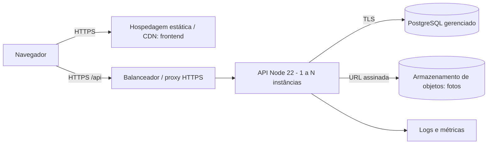

# Migração para a nuvem - diagnóstico e plano (NÃO executado)

Estado: **preparação apenas**. Nenhum serviço de nuvem foi criado, contratado ou acessado; nenhum dado foi movido; nenhuma conta, chave ou custo existe por causa deste documento. O sistema continua funcionando 100% local por padrão. O modo nuvem é opcional, ativado por variáveis de ambiente, e convive com o modo local.

Premissa: **não se presume que qualquer serviço de nuvem já esteja contratado.** Todos os valores de custo abaixo são ordens de grandeza **estimadas**, que dependem de região, câmbio, impostos, desconto e uso, e precisam ser conferidos na calculadora do provedor antes de decidir.

## 1. Dependências do ambiente local (inventário)

| Dependência | Onde | O que fazer na nuvem |
| --- | --- | --- |
| Banco em `localhost` (padrão de `DB_HOST`) | `backend/src/config/database.js` | Apontar `DB_HOST`/`DB_PORT`/`DB_NAME`/`DB_USER`/`DB_PASSWORD` para o PostgreSQL gerenciado e ativar `DB_SSL=true` (+ `DB_SSL_CA_FILE` se a CA não for pública) |
| Origem da API fixa em `http://<hostname>:3000/api` | `frontend/src/services/api.js` | Definir `VITE_API_URL` no build (`/api` se o frontend e a API ficarem no mesmo domínio atrás de um proxy, ou a URL HTTPS da API). O padrão não foi alterado para não quebrar o modo local |
| CORS: `localhost` e regex de rede local fora de produção | `backend/src/app.js` | `CORS_ORIGINS` com o(s) domínio(s) HTTPS do frontend (obrigatório em produção) |
| Fotos em disco local (`backend/uploads`) | `storageService.js` | `STORAGE_DRIVER=s3` + `S3_*`; migrar o acervo com `npm run uploads:s3` |
| Backup com `pg_dump` local, caminhos do Windows e agendador dentro do processo | `backupService.js` | Usar backup gerenciado do banco (snapshots + PITR); desligar `BACKUP_AUTOMATICO` na nuvem. O agendador em processo duplica a execução se houver mais de uma instância |
| Rate limit em memória | `app.js` | Com mais de uma instância, cada uma conta separado; usar armazenamento compartilhado (Redis) ou limite no balanceador/WAF |
| IP do cliente atrás de proxy | `app.js` | `TRUST_PROXY=<nº de proxies>`; sem isso o rate limit enxerga o IP do balanceador |
| `/uploads` público | `app.js` | Hoje a "senha" é o nome aleatório do arquivo; no S3 o redirecionamento também é sem login (ver 7) |
| Imagens `/uploads/teste-*.jpg` do seed de carga | `scripts/seed-carga.js` | Só em banco de teste; não migrar |
| CSP/CORS de imagens | `frontend` e `helmet` | Se as fotos passarem a vir de um host do S3/CDN, liberar esse host em `img-src` |
| Swagger | `app.js` | Desligado por padrão em produção (`DOCS_ENABLED`) |

## 2. Arquitetura alvo (genérica)

Componentes e alternativas (escolha um provedor; os nomes são exemplos, não indicação de que existam contas):

| Função | AWS | Alternativas equivalentes |
| --- | --- | --- |
| Frontend estático | S3 + CloudFront | Netlify, Vercel, Cloudflare Pages |
| API (contêiner) | App Runner ou ECS Fargate | Cloud Run, Azure Container Apps, Fly.io, Render, uma VM com Docker |
| PostgreSQL gerenciado | RDS (PostgreSQL 16+) | Cloud SQL, Azure Database, Neon, Supabase |
| Fotos | S3 (o driver usa API compatível com S3: serve também R2/MinIO via `S3_ENDPOINT`, se configurado) | Cloudflare R2, Backblaze B2, MinIO |
| Segredos | Secrets Manager / SSM Parameter Store | Secret Manager do provedor, variáveis do serviço |
| Logs/alertas | CloudWatch | Provedor equivalente, Grafana/Loki |

Para o porte atual (uma oficina, dezenas de usuários), a opção mais simples e barata costuma ser **uma única VM pequena com Docker (API + proxy HTTPS) e banco gerenciado**, ou tudo na mesma VM com backups rotineiros para fora dela.

## 3. Custos (estimativas; conferir antes de contratar)

Ordem de grandeza mensal em dólares, região de baixo custo, uso leve. Não são cotações.

| Cenário | Componentes | Estimativa |
| --- | --- | --- |
| A. Mínimo | 1 VM pequena (2 vCPU/2 GB) com API + proxy, PostgreSQL na própria VM com backup externo, armazenamento de objetos | ~US$ 10 a 30 |
| B. Gerenciado enxuto | Contêiner pequeno + PostgreSQL gerenciado de entrada (2 vCPU/2 GB, ~20-50 GB) + armazenamento de objetos + hospedagem estática | ~US$ 50 a 120 |
| C. Alta disponibilidade | 2 instâncias da API + balanceador + banco Multi-AZ + CDN + monitoramento | ~US$ 200 ou mais |

Custos de dados: fotos em armazenamento de objetos custam centavos por GB/mês; a saída de dados (download) costuma ser o item que cresce. Backups e snapshots entram no armazenamento. Estas faixas **não foram validadas contra preços atuais**.

## 4. Mudanças de código

Já feitas (e testadas localmente, sem nuvem real):

- Validação de ambiente na subida (`ambiente.js`): `JWT_SECRET` forte, CORS obrigatório em produção, banco remoto exige TLS, `STORAGE_DRIVER`/`S3_BUCKET` coerentes.
- TLS com validação de certificado para o banco (`dbSsl.js`), pool configurável (`DB_POOL_MAX`).
- Armazenamento duplo (`storageService.js`): `local` (padrão) e `s3`. A URL gravada no banco é sempre `/uploads/<pasta>/<arquivo>`, portátil entre os dois modos; no S3 a API responde com redirecionamento 302 para uma URL assinada de curta duração (padrão 300 s).
- Script de cópia das fotos (`npm run uploads:s3`): simula por padrão, `--aplicar` envia, nunca apaga, é idempotente e relata inválidos/ausentes/falhas.
- `/health` e `/ready`, encerramento gracioso (SIGTERM), `TRUST_PROXY`, Swagger desligado em produção.
- Schema em arquivo único (`DB/schema.sql`), idempotente, aplicado manualmente; a API não altera o schema na subida.

Falta fazer na hora da migração (não feito):

1. Empacotar a API (Dockerfile) e o frontend (`VITE_API_URL` no build).
2. Desligar `BACKUP_AUTOMATICO` e usar o backup do banco gerenciado; testar restauração.
3. Se houver mais de uma instância: limite de requisições compartilhado e um único agendador.
4. Revisar a exposição de `/uploads` (item 7).
5. Rodar a suíte contra um PostgreSQL com TLS real e contra um bucket real de homologação.

## 5. Plano passo a passo

1. **Decidir** o cenário (seção 3) e criar as contas/serviços necessários (por decisão do responsável).
2. **Homologação**: subir um banco vazio gerenciado, definir as variáveis (`DB_*`, `DB_SSL=true`, `JWT_SECRET` novo e longo, `CORS_ORIGINS`, `TRUST_PROXY`, `STORAGE_DRIVER=s3`, `S3_*`, `DOCS_ENABLED=false`), rodar `psql -f DB/schema.sql` no banco novo e `npm test` apontando para um banco `_test` da mesma instância.
3. **Dados**: backup completo do banco local (`pg_dump -Fc`); restaurar no banco gerenciado (`pg_restore`); conferir contagens por tabela. Ensaiar duas vezes antes do dia.
4. **Fotos**: `npm run uploads:s3` (simulação), revisar o relatório, depois `--aplicar`; repetir no dia (é idempotente) para pegar arquivos novos.
5. **Frontend**: build com `VITE_API_URL` e publicação; conferir CORS e imagens (CSP).
6. **Validação**: `/ready` = 200; login; criar cliente e O.S. com foto; listagens, busca e filtros; E2E apontado para homologação.
7. **Virada**: congelar escrita no sistema local (janela combinada), repetir o passo 3 incremental (dump final), repetir o passo 4, trocar DNS/URL, manter o sistema local **somente leitura** por alguns dias.
8. **Depois**: alertas (5xx, latência, conexões do banco, disco, falha de backup), teste de restauração mensal, rotação de segredos.
9. **Reversão**: enquanto o local estiver intacto, voltar é trocar a URL; depois que a nuvem receber dados novos, voltar exige novo dump da nuvem para o local.

Convivência local x nuvem: o padrão continua local (`STORAGE_DRIVER` ausente = disco, `DB_SSL` ausente = sem TLS, sem exigências de produção). Cada ambiente usa o seu `.env`; o schema é o mesmo arquivo.

## 6. Pontos técnicos para várias instâncias

- **Sessões/JWT**: sem estado no servidor (token assinado); todas as instâncias precisam do mesmo `JWT_SECRET`.
- **Pool x instâncias**: `instâncias x DB_POOL_MAX` deve ficar abaixo de `max_connections` do banco (com folga para backup e administração). Medido no soak: a API chegou ao teto do pool (20 conexões) sob 50 usuários simultâneos; o PostgreSQL local atendeu sem erros.
- **Rate limit**: em memória por instância (ver seção 1).
- **Schema**: rodar `DB/schema.sql` uma vez, manualmente, antes de subir a nova versão (é idempotente).
- **Agendador de backup**: roda dentro do processo; desativar nas instâncias de nuvem.
- **Tempo de resposta**: ver [OPERACAO_E_VALIDACAO.md](OPERACAO_E_VALIDACAO.md); números medidos em máquina local, **não** representam a nuvem.

## 7. Segurança e conformidade

- HTTPS obrigatório (terminação no balanceador/CDN); `TRUST_PROXY` coerente.
- TLS com validação até o banco; nunca `DB_SSL_REJECT_UNAUTHORIZED=false` em produção.
- Segredos fora do repositório (`.env` já é ignorado pelo Git); gerar novo `JWT_SECRET` (todos farão login de novo).
- Bucket privado, sem listagem pública; credenciais de mínimo privilégio (Put/Get/Delete/Head no prefixo do sistema). Opcional: criptografia no servidor (`S3_SSE`).
- `/uploads`: fotos de clientes são dados pessoais. Hoje o acesso é por URL não adivinhável. Para exigir login, seria preciso autenticar a rota de fotos (o navegador não envia o cabeçalho `Authorization` em ``; exige cookie ou URL assinada gerada por rota autenticada). Decisão pendente do responsável (LGPD).
- Backups: criptografados, com retenção definida e teste de restauração.

## 8. Limitações deste trabalho

- Nada foi executado em nuvem: S3, RDS/PostgreSQL gerenciado, TLS real, balanceador e CDN **não foram validados**; o driver S3 foi testado com um cliente simulado e com a assinatura de URL offline.
- Custos são estimativas sem cotação.
- Nenhuma migração foi aplicada em produção.
